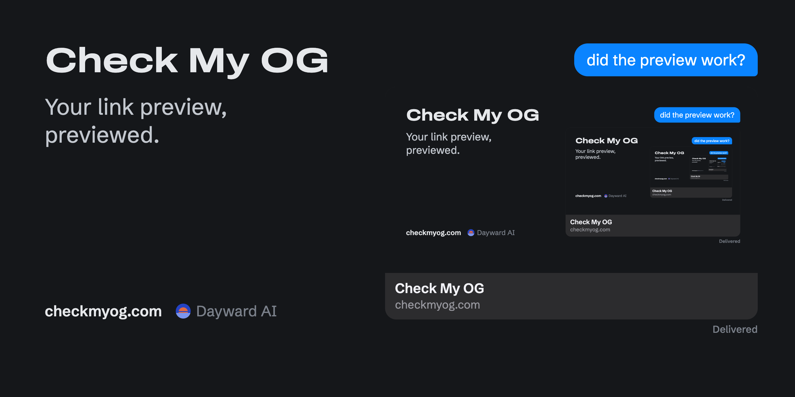

# Check My OG

[](https://checkmyog.com)

See how a link will preview before you share it. [checkmyog.com](https://checkmyog.com)

Most link-preview checkers read your tags and stop. This one fetches the page the way Twitterbot and facebookexternalhit do, then downloads the files the tags point at and checks them: whether `og:image` is a real 1.91:1 image the right size, whether `og:video` is H.264, yuv420p, faststart, served as `video/mp4` with range requests and small enough for iMessage. It then tells you which apps will play the video and which will show the poster, with a source for each claim.

Short version of what it has found so far: iMessage autoplays `og:video`, Discord shows it with a play button, and everyone else (X, Facebook, LinkedIn, Slack, WhatsApp, Telegram, Bluesky, Mastodon, Signal, Matrix) shows `og:image`, so that image matters most. X also covers its bottom-left corner with the domain, so keep text and logos out of there. Without `og:image`, iMessage and the Facebook crowd fall back to the page title in a text-only card; with no og tags at all, Discord and X show nothing but the link. The current list with sources is in [`public/support.json`](public/support.json).

## Use it

- In a browser: `https://checkmyog.com/?url=https://example.com/`
- Markdown report (good for pasting into a model): `curl -s "https://checkmyog.com/api/inspect?url=https://example.com/&format=md"`
- JSON: `curl -s "https://checkmyog.com/api/inspect?url=https://example.com/"`

No key and no sign-in, 20 checks a minute per IP. [`llms.txt`](public/llms.txt) explains the API for agents and [`openapi.json`](public/openapi.json) describes it.

## Run it yourself

It is one Python file using only the standard library, plus `ffprobe` from ffmpeg.

```sh
python3 server.py                     # http://localhost:8080
python3 -m unittest discover -s tests
```

Or with Docker: `docker build -t checkmyog . && docker run -p 8080:8080 checkmyog`

| Variable | Default | What it does |
|---|---|---|
| `PORT` | `8080` | Port to listen on |
| `PUBLIC_URL` | `https://checkmyog.com` | Base URL written into the page, `llms.txt` and `openapi.json` |
| `POSTHOG_KEY` | unset | PostHog project key. Unset means no analytics at all |
| `POSTHOG_HOST` | `https://us.i.posthog.com` | PostHog ingest host |
| `CLIENT_IP_HEADER` | `Fly-Client-IP` | Header your proxy sets with the client IP, used for rate limiting. Set it empty if nothing in front of the server sets one |

## How it works

`server.py` serves `public/` and one endpoint, `/api/inspect`. The page in `public/index.html` calls that endpoint, draws the previews and runs a few checks in your own browser (can it decode the video, does the poster load, does the fallback work).

The server fetches URLs that anyone types in, so it guards against SSRF: every hop, redirects included, resolves the host, refuses private, loopback, link-local and reserved addresses, and connects to the IP it checked, so DNS can't be rebound between the check and the request. Only http and https on ports 80 and 443. Downloads are size-capped and there is a per-IP rate limit.

## Privacy

The hosted site at checkmyog.com uses cookieless PostHog analytics (no cookies, no banner) and records each URL that gets checked, through the page or the API. Visitors are counted with a daily hash, not a stored IP. If you'd rather nothing be recorded, run your own copy; with `POSTHOG_KEY` unset it sends nothing anywhere.

## Contributing

Issues and pull requests are welcome, from people and from AI agents. If an app previews a link differently than this tool says, that is the most useful issue you can file. See [CONTRIBUTING.md](CONTRIBUTING.md).

## License

MIT. Made by [Dayward AI](https://daywardai.com/?utm_source=checkmyog-github).
